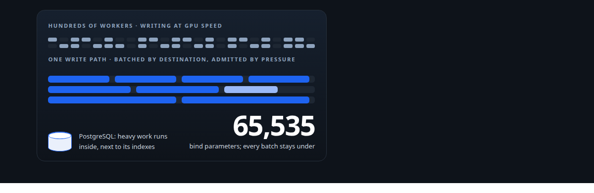
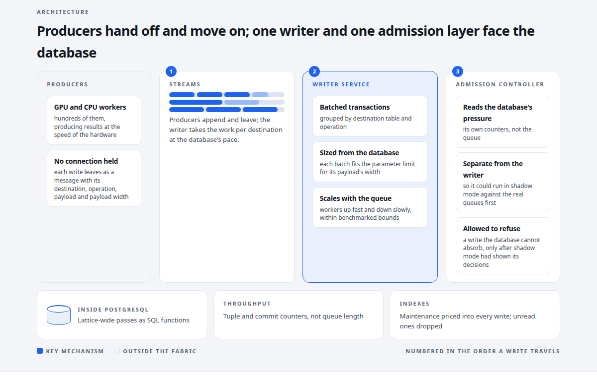
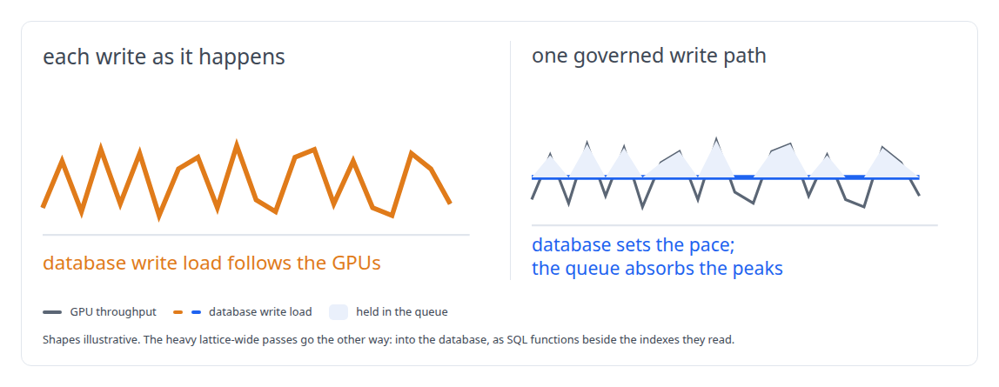
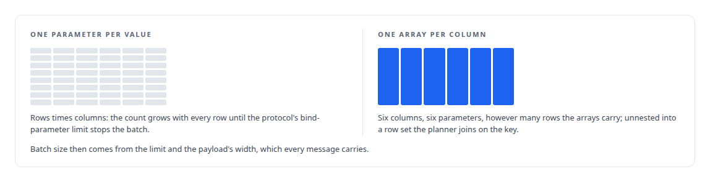
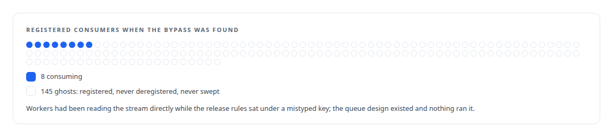
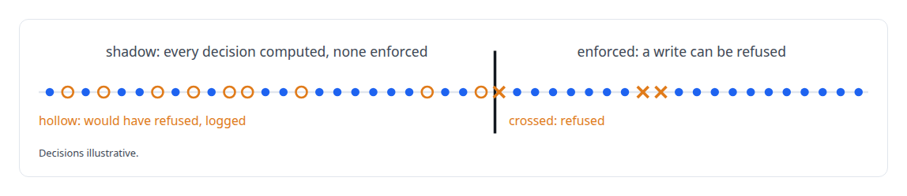
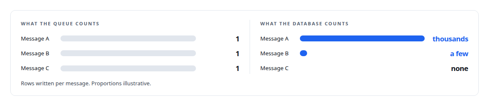

# PostgreSQL Fabric

**One governed write path for a GPU-scale estate: batches sized from the database's own limits, workers that follow the queue, admission that reads the database's pressure, and the heavy work run inside the database next to its indexes**

Canonical: https://coreyjames.ai/systems/postgresql-fabric/  
Author: Corey James · Published: 2026-10-28 · Kind: system  
DOI: https://doi.org/10.5281/zenodo.23735156  
Technologies: [Admission control and rate limiting](https://github.com/coreyjames-ai/portfolio/tree/main/technologies/admission-control-and-rate-limiting) · [Database performance diagnosis](https://github.com/coreyjames-ai/portfolio/tree/main/technologies/database-performance-diagnosis) · [Lua](https://github.com/coreyjames-ai/portfolio/tree/main/technologies/lua) · [MessagePack](https://github.com/coreyjames-ai/portfolio/tree/main/technologies/messagepack) · [PostgreSQL](https://github.com/coreyjames-ai/portfolio/tree/main/technologies/postgresql) · [PostgreSQL bulk-update engineering](https://github.com/coreyjames-ai/portfolio/tree/main/technologies/postgresql-bulk-update-engineering) · [Redis](https://github.com/coreyjames-ai/portfolio/tree/main/technologies/redis) · [Rust](https://github.com/coreyjames-ai/portfolio/tree/main/technologies/rust) · [SQL](https://github.com/coreyjames-ai/portfolio/tree/main/technologies/sql) · [Schema and migration discipline](https://github.com/coreyjames-ai/portfolio/tree/main/technologies/schema-and-migration-discipline) · [Write-behind persistence](https://github.com/coreyjames-ai/portfolio/tree/main/technologies/write-behind-persistence) · [pgvector](https://github.com/coreyjames-ai/portfolio/tree/main/technologies/pgvector) · [sqlx](https://github.com/coreyjames-ai/portfolio/tree/main/technologies/sqlx)  
Skills: [PostgreSQL performance tuning](https://github.com/coreyjames-ai/portfolio/tree/main/skills/postgresql-performance-tuning) · [Rust systems engineering](https://github.com/coreyjames-ai/portfolio/tree/main/skills/rust-systems-engineering) · [database admission control](https://github.com/coreyjames-ai/portfolio/tree/main/skills/database-admission-control) · [tool synthesis and governed API integration](https://github.com/coreyjames-ai/portfolio/tree/main/skills/tool-synthesis-and-governed-api-integration)  



## Result

| Figure | What it measures |
| --- | --- |
| **0.3 s** | a batch update that had taken more than 25 seconds |
| **400 GB** | of indexes that no query had ever read, removed |
| **16,000** | lines of Rust in the writer and its library, the queue logic in Lua |



## What was built

Every system in my estate reads PostgreSQL directly and writes it through one path. Hundreds of GPU and CPU workers produce results at the speed of the hardware, and a database that received each of those writes as it happened would spend its life holding connections and locks across GPU waits, with write load tracking GPU throughput rather than what the database can absorb. PostgreSQL Fabric is the layer that turns that firehose into batched, ordered, admitted writes, and that carries the work which belongs inside the database to the database.

## The idea

Producers never hold a database connection for a write. Each write is serialised into a stream message with its destination, its operation, its payload and the width of that payload, and the producer moves on. One writer service consumes the streams, groups messages by destination table and operation, and writes them in batched transactions. An admission controller, separate from the writer, measures the database's own pressure and spends it. Lattice-wide operations, the redistribution passes and health computations over millions of rows, run as SQL functions inside PostgreSQL rather than being dragged out through a client.



## Statements shaped for the database

Bulk updates bind each column as one array and unnest the arrays into a row set, so the number of parameters equals the number of columns whatever the row count, and the planner joins on the key instead of materialising a derived table. That change and the index removal are the story in [Twenty thousand rows a second](https://coreyjames.ai/stories/twenty-thousand-rows-a-second). Batches are sized per destination from the parameter limit and the payload's width, which the producer stamps on every message, and writer workers scale with queue depth, up fast and down slowly, within bounds that came from a benchmark: [A write path that sizes itself](https://coreyjames.ai/stories/a-write-path-that-sizes-itself).



## The queue as a design, and the time it was ignored

Each worker takes one full batch for one destination through an atomic claim, partial batches release by priority and age, and consumers deregister themselves and are swept when they do not. That design was once silently bypassed: workers read the stream directly, the release rules sat under a mistyped key, and almost every registered consumer was a ghost. The diagnosis and the rebuild are in [Rules that never ran](https://coreyjames.ai/stories/rules-that-never-ran).



## Admission from the database's own pressure

A sampler reads the write-ahead-log rate, active writers, lock waits and per-function statement statistics into a pressure index. Token buckets in several dimensions refill fully when the database is healthy, partially under warning, and not at all at critical pressure, with gradual recovery. Row writes travel one lane and heavy in-database functions another, run one at a time under a lock that cannot be held by a crashed or stale holder. The controller ran in shadow mode, computing every decision without enforcing one, before it was allowed to refuse a write: [Pricing writes by what they cost the database](https://coreyjames.ai/stories/pricing-writes-by-what-they-cost).



## Measured at the source

Throughput is read from the database's own tuple and commit counters, never from queue length, because one message can carry thousands of rows or none. The deadlock investigation in [196 deadlocks to zero](https://coreyjames.ai/stories/196-deadlocks-to-zero) was done that way, and the in-database redistribution engine of [Redistribution inside the database](https://coreyjames.ai/stories/redistribution-inside-the-database) runs on this fabric.



## The judgment in it

I removed the batch-size settings from the operator's tool surface.


I kept the admission controller separate from the writer, so the writer stays simple and admission can be run in shadow mode against the real queues.

I chose to acknowledge a batch that keeps failing rather than let it block the queue, and I keep that trade-off visible rather than hidden behind a dead-letter mechanism that does not exist.

I count index maintenance as part of the cost of every write, and I drop indexes that no query reads.

## What it demonstrates

Database engineering at the scale of a GPU estate: PostgreSQL's limits handled as engineering constraints, throughput measured where it is true, and a write path whose sizing and admission are derived from the database rather than configured by hand. The admission controller is about 5,000 lines of Rust.

## Stories

[Twenty thousand rows a second](https://coreyjames.ai/stories/twenty-thousand-rows-a-second) · [A write path that sizes itself](https://coreyjames.ai/stories/a-write-path-that-sizes-itself) · [Rules that never ran](https://coreyjames.ai/stories/rules-that-never-ran) · [Pricing writes by what they cost the database](https://coreyjames.ai/stories/pricing-writes-by-what-they-cost) · [196 deadlocks to zero](https://coreyjames.ai/stories/196-deadlocks-to-zero) · [Redistribution inside the database](https://coreyjames.ai/stories/redistribution-inside-the-database) · [The database decides when an index goes stale](https://coreyjames.ai/stories/the-database-decides-when-an-index-goes-stale) · [Rebuild only what moved](https://coreyjames.ai/stories/rebuild-only-what-moved) · [Three shards that move together](https://coreyjames.ai/stories/three-shards-that-move-together)

## Technologies

PostgreSQL · PostgreSQL bulk-update engineering · Write-behind persistence · Admission control and rate limiting · Redis streams and Lua · sqlx · Database performance diagnosis · pgvector · Rust

> A self-tuning system that can be hand-tuned will be mistuned.

## What was verified

Each line is a claim the canonical page supports, with the figure as the page states it.

- PostgreSQL performance tuning: a batch update that had taken more than 25 seconds brought to 0.3 s.
- Index cost analysis: 400 GB of indexes that no query had ever read, removed and counted as write cost.
- Write-behind persistence: hundreds of GPU and CPU workers hand off their writes and move on, with no producer holding a database connection.
- Database admission control: writes admitted against the database's own pressure, proven in shadow mode before it could refuse one.
- Rust systems engineering: 16,000 lines of Rust in the writer and its library, with the queue logic in Lua.

## Related

- [Twenty thousand rows a second](https://github.com/coreyjames-ai/postgresql-fabric/tree/main/stories/twenty-thousand-rows-a-second) · https://coreyjames.ai/stories/twenty-thousand-rows-a-second/
- [A write path that sizes itself](https://github.com/coreyjames-ai/postgresql-fabric/tree/main/stories/a-write-path-that-sizes-itself) · https://coreyjames.ai/stories/a-write-path-that-sizes-itself/
- [Rules that never ran](https://github.com/coreyjames-ai/postgresql-fabric/tree/main/stories/rules-that-never-ran) · https://coreyjames.ai/stories/rules-that-never-ran/
- [Pricing writes by what they cost the database](https://github.com/coreyjames-ai/postgresql-fabric/tree/main/stories/pricing-writes-by-what-they-cost) · https://coreyjames.ai/stories/pricing-writes-by-what-they-cost/
- [196 deadlocks to zero](https://github.com/coreyjames-ai/fafo-core/tree/main/stories/196-deadlocks-to-zero) · https://coreyjames.ai/stories/196-deadlocks-to-zero/
- [Redistribution inside the database](https://github.com/coreyjames-ai/fafo-core/tree/main/stories/redistribution-inside-the-database) · https://coreyjames.ai/stories/redistribution-inside-the-database/
- [The database decides when an index goes stale](https://github.com/coreyjames-ai/inference-fabric/tree/main/stories/the-database-decides-when-an-index-goes-stale) · https://coreyjames.ai/stories/the-database-decides-when-an-index-goes-stale/
- [Rebuild only what moved](https://github.com/coreyjames-ai/inference-fabric/tree/main/stories/rebuild-only-what-moved) · https://coreyjames.ai/stories/rebuild-only-what-moved/
- [Three shards that move together](https://github.com/coreyjames-ai/inference-fabric/tree/main/stories/three-shards-that-move-together) · https://coreyjames.ai/stories/three-shards-that-move-together/

## Skills demonstrated

Decided at build time against every page in this system, strongest first; each links to the page that earns it.

- [PostgreSQL performance tuning](https://github.com/coreyjames-ai/portfolio/tree/main/skills/postgresql-performance-tuning) · [Twenty thousand rows a second](https://github.com/coreyjames-ai/postgresql-fabric/tree/main/stories/twenty-thousand-rows-a-second)
- [Rust systems engineering](https://github.com/coreyjames-ai/portfolio/tree/main/skills/rust-systems-engineering) · [PostgreSQL Fabric](https://github.com/coreyjames-ai/postgresql-fabric)
- [database admission control](https://github.com/coreyjames-ai/portfolio/tree/main/skills/database-admission-control) · [Pricing writes by what they cost the database](https://github.com/coreyjames-ai/postgresql-fabric/tree/main/stories/pricing-writes-by-what-they-cost)
- [message broker and queue design](https://github.com/coreyjames-ai/portfolio/tree/main/skills/message-broker-and-queue-design) · [Rules that never ran](https://github.com/coreyjames-ai/postgresql-fabric/tree/main/stories/rules-that-never-ran)
- [observability and alerting](https://github.com/coreyjames-ai/portfolio/tree/main/skills/observability-and-alerting) · [Rules that never ran](https://github.com/coreyjames-ai/postgresql-fabric/tree/main/stories/rules-that-never-ran)
- [distributed systems correctness](https://github.com/coreyjames-ai/portfolio/tree/main/skills/distributed-systems-correctness) · [Pricing writes by what they cost the database](https://github.com/coreyjames-ai/postgresql-fabric/tree/main/stories/pricing-writes-by-what-they-cost)

## Engineering stories in PostgreSQL Fabric (4)

| Story | Result | Figure |
| --- | --- | --- |
| [Twenty thousand rows a second](stories/twenty-thousand-rows-a-second) | A batch update that took twenty-five seconds became a third of a second: one SQL rewrite that makes parameter count independent of row count, and nearly 400 GB of indexes that nobody had ever read | 0.3 s |
| [A write path that sizes itself](stories/a-write-path-that-sizes-itself) | Batches sized from the payload's own width under PostgreSQL's parameter limit, writer workers that follow queue demand, and the batch-size knobs deliberately taken away from operators | ~240 |
| [Rules that never ran](stories/rules-that-never-ran) | The writer's batch-release rules had been silently unused, workers were grabbing whatever arrived, and 145 of 153 stream consumers were ghosts; how the write path was found out and rebuilt | 8 of 153 |
| [Pricing writes by what they cost the database](stories/pricing-writes-by-what-they-cost) | An admission controller that reads the database's own pressure, write-ahead-log rate, active writers and lock waits, and admits work only as fast as the database can take it | 4 |

Part of [Corey James's portfolio](https://github.com/coreyjames-ai/portfolio): research, technologies, skills and the other systems. Canonical site: https://coreyjames.ai/

## Citation

Corey James. "PostgreSQL Fabric." coreyjames.ai, 2026. https://coreyjames.ai/systems/postgresql-fabric/ In: the PostgreSQL Fabric technical report, doi:10.5281/zenodo.23735156.

```bibtex
@misc{coreyjames-postgresql-fabric,
  author = {Corey James},
  title = {PostgreSQL Fabric},
  year = {2026},
  howpublished = {\url{https://coreyjames.ai/systems/postgresql-fabric/}},
  note = {GitHub copy: https://github.com/coreyjames-ai/postgresql-fabric},
  doi = {10.5281/zenodo.23735156}
}
```

Part of [PostgreSQL Fabric](https://github.com/coreyjames-ai/postgresql-fabric) and [Corey James's portfolio](https://github.com/coreyjames-ai/portfolio) · site: https://coreyjames.ai/ · MCP server: https://coreyjames.ai/mcp · agent card: https://coreyjames.ai/.well-known/agent.json
