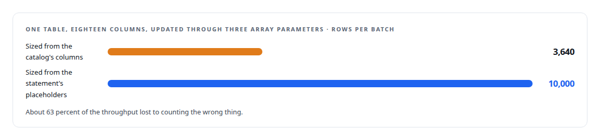
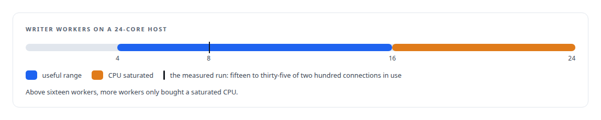
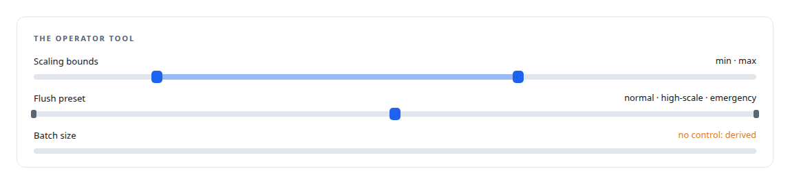
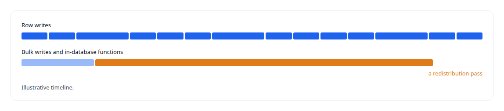

# A write path that sizes itself

**Batches sized from the payload's own width under PostgreSQL's parameter limit, writer workers that follow queue demand, and the batch-size knobs deliberately taken away from operators**

Canonical: https://coreyjames.ai/stories/a-write-path-that-sizes-itself/  
Author: Corey James · Published: 2026-10-28 · Kind: story  
DOI: https://doi.org/10.5281/zenodo.23735156 (this page is a chapter of the system's report)  
Systems: [PostgreSQL Fabric](https://github.com/coreyjames-ai/postgresql-fabric) · [FAFO Core and Function Forge](https://github.com/coreyjames-ai/fafo-core) · [Inference Fabric](https://github.com/coreyjames-ai/inference-fabric)  
Technologies: [Capacity engineering, backpressure and load testing](https://github.com/coreyjames-ai/portfolio/tree/main/technologies/capacity-engineering-backpressure-and-load-testing) · [PostgreSQL](https://github.com/coreyjames-ai/portfolio/tree/main/technologies/postgresql) · [PostgreSQL bulk-update engineering](https://github.com/coreyjames-ai/portfolio/tree/main/technologies/postgresql-bulk-update-engineering) · [Redis](https://github.com/coreyjames-ai/portfolio/tree/main/technologies/redis) · [Rust](https://github.com/coreyjames-ai/portfolio/tree/main/technologies/rust) · [Write-behind persistence](https://github.com/coreyjames-ai/portfolio/tree/main/technologies/write-behind-persistence)  
Skills: [PostgreSQL performance tuning](https://github.com/coreyjames-ai/portfolio/tree/main/skills/postgresql-performance-tuning)  


## Result

| Figure | What it measures |
| --- | --- |
| **~240** | updates per second each writer worker sustained in the benchmark |
| **~1,929** | updates per second held at eight workers |
| **99.25%** | buffer hit rate on that run, with I/O wait under 0.2 percent |

## What was built

Every function in my estate reads PostgreSQL directly and writes it through one service. Producers serialise each write into a stream message and move on; a writer service consumes the streams, groups messages by destination table and operation, and writes them in batched transactions at the pace the database can absorb. The interesting part is that nobody tells it how big a batch should be or how many workers to run.

## Batches sized from the payload

PostgreSQL caps the bind parameters in one statement. A batch that exceeds the limit fails outright, and a batch far below it wastes round trips. The right batch size therefore depends on how many parameters each row binds, which depends on the destination and the operation. So every producer stamps its message with the width of its own payload, the writer aggregates per destination, and the batch size for that destination is derived from the limit and that width. The library underneath re-chunks by the same rule as a second line of defence.

The first version got this wrong in an instructive way. It sized batches from the destination table's column count, read from the catalog, when what the limit counts is placeholders in the statement. A table with eighteen columns updated through three array parameters was being batched far below what it could take.




## Workers that follow the queue

The writer runs a pool of workers sized from demand. A coordinator measures the queue depth, estimates how many full batches it represents, and scales the pool toward that number: up quickly when the backlog grows, down slowly after it has drained, stopping the newest workers first. Dispatch is held back while more batches are outstanding than there are workers, which is the backpressure that keeps the pool from outrunning the database. Each worker takes one full batch for one destination, claimed atomically so that two workers never compete for the same messages, and partial batches are released by priority and age so a small table is not starved behind a large one.

The pool's bounds came from a benchmark rather than a guess, on a 24-core host writing tier-two health metrics across about four million rows.



## Knobs removed on purpose

The batch-size settings are not on the operator's tool surface. A self-tuning system that can be hand-tuned is a system that will be mistuned, so the operator tool exposes status, scaling bounds, queue metrics, rule presets for normal, high-scale and emergency flush, and configuration persistence with atomic writes, backup, rollback and an audit trail, and nothing that sets a batch size directly.



## Two lanes

Row writes and lattice-wide operations do not share a queue. Inserts, updates, upserts and deletes travel one lane; bulk updates, multi-row inserts and calls to SQL functions that run inside the database travel another, so a long-running redistribution pass, told in [Redistribution inside the database](https://coreyjames.ai/stories/redistribution-inside-the-database), can never starve the row writes behind it. Results that span parent and child tables are written as one ordered message and committed in one transaction, so they never land half-written.



## What this demonstrates

A write path engineered around the database's real limits and its own measurements: batch width derived from the protocol limit and the payload, worker count derived from the queue and bounded by a benchmark, and configuration designed so the system cannot be mis-set by hand.

The sizing rules and the decision to remove the knobs were mine; AI coding agents, a mix of frontier and open-source models, implemented the service under my governance system.

> The fix moved the width to where it is known, the producer.

## What was verified

Each line is a claim the canonical page supports, with the figure as the page states it.

- Capacity engineering and load testing: writer pool bounds taken from a benchmark on a 24-core host, about 240 updates per second per worker, the CPU saturated above 16 workers.
- PostgreSQL performance tuning: batches sized from each payload's own width, fixing a sizing error that held one table at 3,640 rows per batch when it could take 10,000.
- Self-tuning systems design: batch-size settings removed from the operator surface, which keeps status, scaling bounds, presets and audited configuration.
- Write-behind persistence: about 1,929 updates per second held at eight workers with a 99.25% buffer hit rate.

## Related

- [Twenty thousand rows a second](https://github.com/coreyjames-ai/postgresql-fabric/tree/main/stories/twenty-thousand-rows-a-second) · https://coreyjames.ai/stories/twenty-thousand-rows-a-second/
- [Rules that never ran](https://github.com/coreyjames-ai/postgresql-fabric/tree/main/stories/rules-that-never-ran) · https://coreyjames.ai/stories/rules-that-never-ran/
- [196 deadlocks to zero](https://github.com/coreyjames-ai/fafo-core/tree/main/stories/196-deadlocks-to-zero) · https://coreyjames.ai/stories/196-deadlocks-to-zero/
- [Redistribution inside the database](https://github.com/coreyjames-ai/fafo-core/tree/main/stories/redistribution-inside-the-database) · https://coreyjames.ai/stories/redistribution-inside-the-database/

## Citation

Corey James. "A write path that sizes itself." coreyjames.ai, 2026. https://coreyjames.ai/stories/a-write-path-that-sizes-itself/ In: the PostgreSQL Fabric technical report, doi:10.5281/zenodo.23735156.

```bibtex
@misc{coreyjames-a-write-path-that-sizes-itself,
  author = {Corey James},
  title = {A write path that sizes itself},
  year = {2026},
  howpublished = {\url{https://coreyjames.ai/stories/a-write-path-that-sizes-itself/}},
  note = {GitHub copy: https://github.com/coreyjames-ai/postgresql-fabric/tree/main/stories/a-write-path-that-sizes-itself},
  doi = {10.5281/zenodo.23735156}
}
```

Part of [PostgreSQL Fabric](https://github.com/coreyjames-ai/postgresql-fabric) and [Corey James's portfolio](https://github.com/coreyjames-ai/portfolio) · site: https://coreyjames.ai/ · MCP server: https://coreyjames.ai/mcp · agent card: https://coreyjames.ai/.well-known/agent.json
