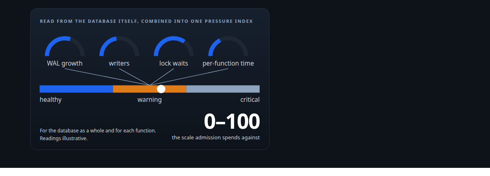
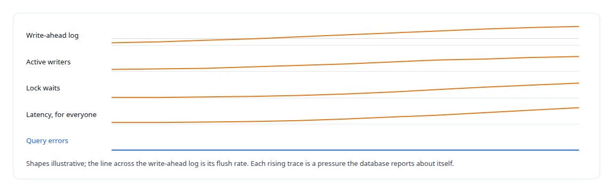
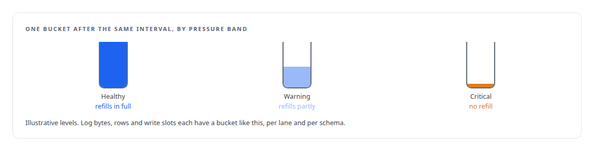
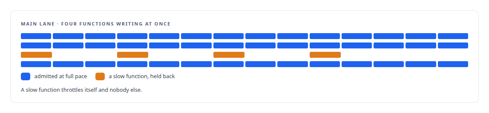
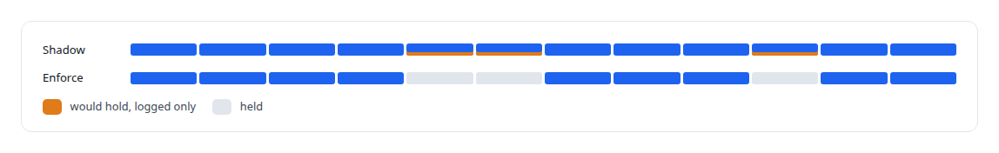

# Pricing writes by what they cost the database

**An admission controller that reads the database's own pressure, write-ahead-log rate, active writers and lock waits, and admits work only as fast as the database can take it**

Canonical: https://coreyjames.ai/stories/pricing-writes-by-what-they-cost/  
Author: Corey James · Published: 2026-10-28 · Kind: story  
DOI: https://doi.org/10.5281/zenodo.23735156 (this page is a chapter of the system's report)  
Systems: [PostgreSQL Fabric](https://github.com/coreyjames-ai/postgresql-fabric) · [FAFO Core and Function Forge](https://github.com/coreyjames-ai/fafo-core) · [Inference Fabric](https://github.com/coreyjames-ai/inference-fabric)  
Technologies: [Admission control and rate limiting](https://github.com/coreyjames-ai/portfolio/tree/main/technologies/admission-control-and-rate-limiting) · [Lua](https://github.com/coreyjames-ai/portfolio/tree/main/technologies/lua) · [PostgreSQL](https://github.com/coreyjames-ai/portfolio/tree/main/technologies/postgresql) · [PostgreSQL bulk-update engineering](https://github.com/coreyjames-ai/portfolio/tree/main/technologies/postgresql-bulk-update-engineering) · [Redis](https://github.com/coreyjames-ai/portfolio/tree/main/technologies/redis) · [Rust](https://github.com/coreyjames-ai/portfolio/tree/main/technologies/rust)  
Skills: [database admission control](https://github.com/coreyjames-ai/portfolio/tree/main/skills/database-admission-control) · [distributed systems correctness](https://github.com/coreyjames-ai/portfolio/tree/main/skills/distributed-systems-correctness) · [inference serving architecture](https://github.com/coreyjames-ai/portfolio/tree/main/skills/inference-serving-architecture) · [embedding analytics and cluster metrics](https://github.com/coreyjames-ai/portfolio/tree/main/skills/embedding-analytics-and-cluster-metrics)  



## Result

| Figure | What it measures |
| --- | --- |
| **4** | pressure signals, all read from the database's own statistics |
| **3** | modes: off, shadow and enforce |
| **1** | lattice-wide function running inside the database at a time |

## What was built

GPU-scale producers can push a database into trouble long before any query fails. The write path described in [A write path that sizes itself](https://coreyjames.ai/stories/a-write-path-that-sizes-itself) keeps the database from being hammered by individual workers; the admission controller keeps the whole fleet from exceeding what the database can absorb.


## Pressure, read from the database

A sampler reads the database's own statistics, the write-ahead log, its writers, its locks and its statement statistics. Each signal is normalised between a healthy level and a critical one, and the signals are combined into one pressure index. The weights are tuned to this estate and stay private; the shape of the index does not.



## Tokens that refill with headroom

Admission is a token bucket in several dimensions at once: log bytes, rows and write slots, per lane and per schema. When pressure is healthy, the buckets refill in full. In a warning band they refill partially. At critical pressure they stop refilling until the database recovers, and recovery is gradual so admission does not oscillate. Each batch presents a cost estimate for its function, and an atomic check in the queue store admits it or holds it. Schemas take turns so one tenant cannot monopolise the buckets, a batch that has waited gains priority with age, and an emergency priority exists for the writes that must land regardless.



## One at a time for the heavy work

Lattice-wide functions that run inside the database, the redistribution passes in [Redistribution inside the database](https://coreyjames.ai/stories/redistribution-inside-the-database), travel the bulk lane and run one at a time, under a lock with a heartbeat and a time-to-live, so a crashed holder cannot block the lane forever and a stale holder cannot release a lock it no longer owns. Row writes on the main lane are gated per function and schema.



## Shadow before enforce

The controller has three modes: off, shadow and enforce. In shadow mode it computes every decision and logs what it would have done without holding anything, which is how its thresholds were set against real load before it was allowed to refuse a write.



## What this demonstrates

Rate limiting derived from the resource being protected rather than from a fixed quota: the database says how much pressure it is under, admission spends against that, and the heavy work is serialised where the contention would be worst.

The pressure model and the lane design are mine; AI coding agents, a mix of frontier and open-source models, implemented the controller under my governance system.

> It measures the database and spends the measurement.

## What was verified

Each line is a claim the canonical page supports, with the figure as the page states it.

- Database admission control: an admission controller that combines 4 pressure signals from the database's own statistics, write-ahead log, writers, locks and statement statistics, into one pressure index for a GPU-scale fleet.
- Rate limiting: token buckets in log bytes, rows and write slots per lane and per schema that refill in full, partly or not at all by pressure band, with an atomic admit-or-hold check in the queue store.
- Distributed systems correctness: lattice-wide in-database functions held to 1 at a time under a lock with a heartbeat and a time-to-live, so a crashed holder cannot block the lane and a stale one cannot release it.
- Shadow-mode rollout: 3 modes, off, shadow and enforce, with shadow mode logging every decision without holding anything, so thresholds were set against real load before any write was refused.
- Multi-tenant fairness: schemas take turns so one tenant cannot monopolise the buckets, waiting batches gain priority with age, and a slow function throttles only its own writes.

## Related

- [A write path that sizes itself](https://github.com/coreyjames-ai/postgresql-fabric/tree/main/stories/a-write-path-that-sizes-itself) · https://coreyjames.ai/stories/a-write-path-that-sizes-itself/
- [Redistribution inside the database](https://github.com/coreyjames-ai/fafo-core/tree/main/stories/redistribution-inside-the-database) · https://coreyjames.ai/stories/redistribution-inside-the-database/
- [196 deadlocks to zero](https://github.com/coreyjames-ai/fafo-core/tree/main/stories/196-deadlocks-to-zero) · https://coreyjames.ai/stories/196-deadlocks-to-zero/

## Citation

Corey James. "Pricing writes by what they cost the database." coreyjames.ai, 2026. https://coreyjames.ai/stories/pricing-writes-by-what-they-cost/ In: the PostgreSQL Fabric technical report, doi:10.5281/zenodo.23735156.

```bibtex
@misc{coreyjames-pricing-writes-by-what-they-cost,
  author = {Corey James},
  title = {Pricing writes by what they cost the database},
  year = {2026},
  howpublished = {\url{https://coreyjames.ai/stories/pricing-writes-by-what-they-cost/}},
  note = {GitHub copy: https://github.com/coreyjames-ai/postgresql-fabric/tree/main/stories/pricing-writes-by-what-they-cost},
  doi = {10.5281/zenodo.23735156}
}
```

Part of [PostgreSQL Fabric](https://github.com/coreyjames-ai/postgresql-fabric) and [Corey James's portfolio](https://github.com/coreyjames-ai/portfolio) · site: https://coreyjames.ai/ · MCP server: https://coreyjames.ai/mcp · agent card: https://coreyjames.ai/.well-known/agent.json
