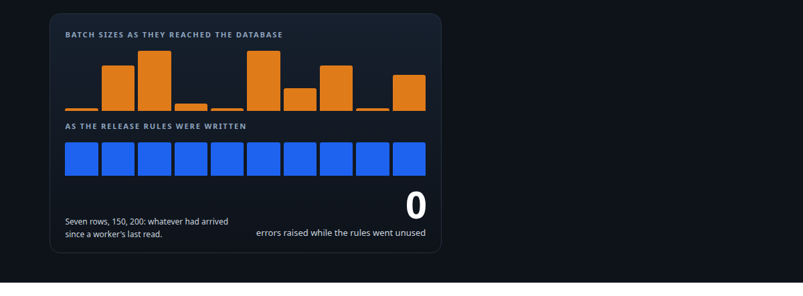
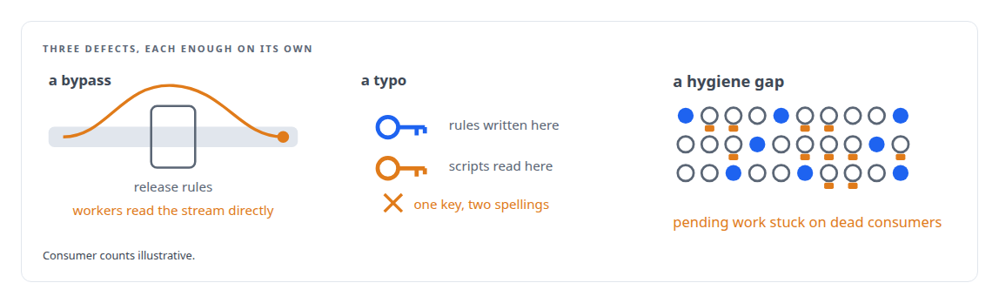
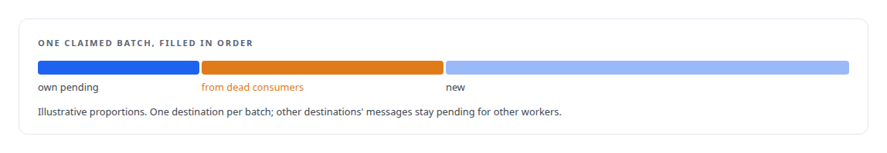
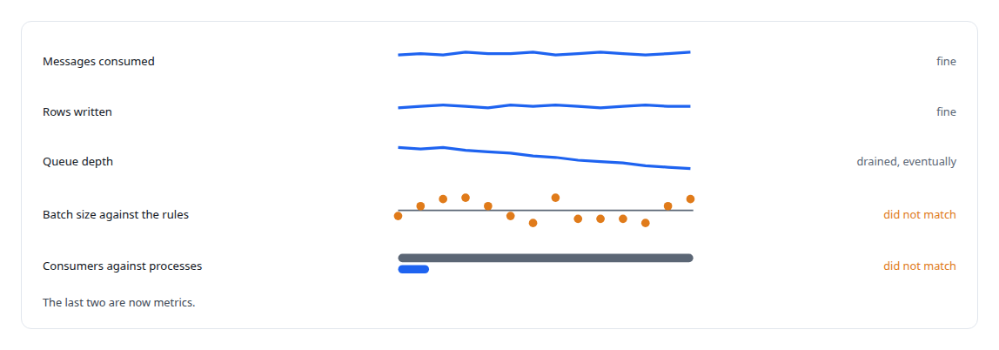

# Rules that never ran

**The writer's batch-release rules had been silently unused, workers were grabbing whatever arrived, and 145 of 153 stream consumers were ghosts; how the write path was found out and rebuilt**

Canonical: https://coreyjames.ai/stories/rules-that-never-ran/  
Author: Corey James · Published: 2026-10-28 · Kind: story  
DOI: https://doi.org/10.5281/zenodo.23735156 (this page is a chapter of the system's report)  
Systems: [PostgreSQL Fabric](https://github.com/coreyjames-ai/postgresql-fabric) · [FAFO Core and Function Forge](https://github.com/coreyjames-ai/fafo-core)  
Technologies: [Database performance diagnosis](https://github.com/coreyjames-ai/portfolio/tree/main/technologies/database-performance-diagnosis) · [Lua](https://github.com/coreyjames-ai/portfolio/tree/main/technologies/lua) · [PostgreSQL bulk-update engineering](https://github.com/coreyjames-ai/portfolio/tree/main/technologies/postgresql-bulk-update-engineering) · [Redis](https://github.com/coreyjames-ai/portfolio/tree/main/technologies/redis) · [Rust](https://github.com/coreyjames-ai/portfolio/tree/main/technologies/rust) · [Write-behind persistence](https://github.com/coreyjames-ai/portfolio/tree/main/technologies/write-behind-persistence)  
Skills: [message broker and queue design](https://github.com/coreyjames-ai/portfolio/tree/main/skills/message-broker-and-queue-design) · [observability and alerting](https://github.com/coreyjames-ai/portfolio/tree/main/skills/observability-and-alerting) · [distributed systems correctness](https://github.com/coreyjames-ai/portfolio/tree/main/skills/distributed-systems-correctness)  



## Result

| Figure | What it measures |
| --- | --- |
| **8 of 153** | registered stream consumers that were alive when measured |
| **47+** | stale consumers left behind by restarts |
| **3** | defects found at once |

## What was built

The write path had rules for when a batch should be released: enough messages for a destination, or enough age, with priorities so urgent writes went first. The rules were written in scripts that ran inside the queue store, and they were correct. They were also never consulted. Batches were arriving at the database in random sizes, with several workers contending for the same messages, and the throughput looked nothing like the design.

## Three defects

The investigation found three things at once. Workers were reading new messages from the stream directly, which bypassed the release scripts entirely, so each worker took whatever had arrived since its last read. The scripts themselves read their rules from one configuration key while the configuration had been written under a slightly different key, so even when they ran they ran with no rules. And the consumer group had filled with stale consumers from restarts, so pending messages assigned to the dead ones sat unclaimed.



## The rebuild

The quick fix routed every read through the gating scripts, corrected the key and added consumer cleanup. The lasting fix replaced the path. A coordinator now scans each destination's queue for its count, oldest age, highest priority and payload width, decides which destinations have a releasable batch, and hands each worker one full batch for one destination through an atomic claim that takes the worker's own pending messages first, then stale pending messages from any dead consumer, then new ones, and leaves non-matching messages pending for other workers. Each worker deregisters itself from the group on exit, and a periodic sweep removes any that did not. Messages that fail are retried with growing delays and a per-worker circuit breaker, and a batch that keeps failing is acknowledged and logged rather than left to block the queue, a trade-off I chose knowingly and keep visible.



## Why it was invisible

Messages were consumed, rows were written, the queue drained eventually.




## What this demonstrates

Reading a system against its own design rather than against its error log: the symptoms were statistical, the causes were a bypass, a typo and a hygiene gap, and the fix made the design the only path.

The diagnosis and the rebuild were my decisions; AI coding agents, a mix of frontier and open-source models, implemented them under my governance system.

> The design was being ignored rather than violated.

## What was verified

Each line is a claim the canonical page supports, with the figure as the page states it.

- Distributed systems debugging: 3 defects found at once, a stream-read bypass, a misnamed configuration key and 47+ stale consumers, none of which raised an error.
- Observability and alerting: the batch-size distribution and consumer-against-process counts turned into metrics after they were the only evidence of the fault.
- Message broker and queue design: a write path rebuilt so the release rules are the only path, after only 8 of 153 registered consumers were found alive.

## Related

- [A write path that sizes itself](https://github.com/coreyjames-ai/postgresql-fabric/tree/main/stories/a-write-path-that-sizes-itself) · https://coreyjames.ai/stories/a-write-path-that-sizes-itself/
- [Twenty thousand rows a second](https://github.com/coreyjames-ai/postgresql-fabric/tree/main/stories/twenty-thousand-rows-a-second) · https://coreyjames.ai/stories/twenty-thousand-rows-a-second/
- [196 deadlocks to zero](https://github.com/coreyjames-ai/fafo-core/tree/main/stories/196-deadlocks-to-zero) · https://coreyjames.ai/stories/196-deadlocks-to-zero/

## Citation

Corey James. "Rules that never ran." coreyjames.ai, 2026. https://coreyjames.ai/stories/rules-that-never-ran/ In: the PostgreSQL Fabric technical report, doi:10.5281/zenodo.23735156.

```bibtex
@misc{coreyjames-rules-that-never-ran,
  author = {Corey James},
  title = {Rules that never ran},
  year = {2026},
  howpublished = {\url{https://coreyjames.ai/stories/rules-that-never-ran/}},
  note = {GitHub copy: https://github.com/coreyjames-ai/postgresql-fabric/tree/main/stories/rules-that-never-ran},
  doi = {10.5281/zenodo.23735156}
}
```

Part of [PostgreSQL Fabric](https://github.com/coreyjames-ai/postgresql-fabric) and [Corey James's portfolio](https://github.com/coreyjames-ai/portfolio) · site: https://coreyjames.ai/ · MCP server: https://coreyjames.ai/mcp · agent card: https://coreyjames.ai/.well-known/agent.json
