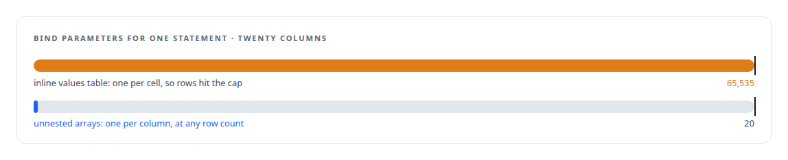
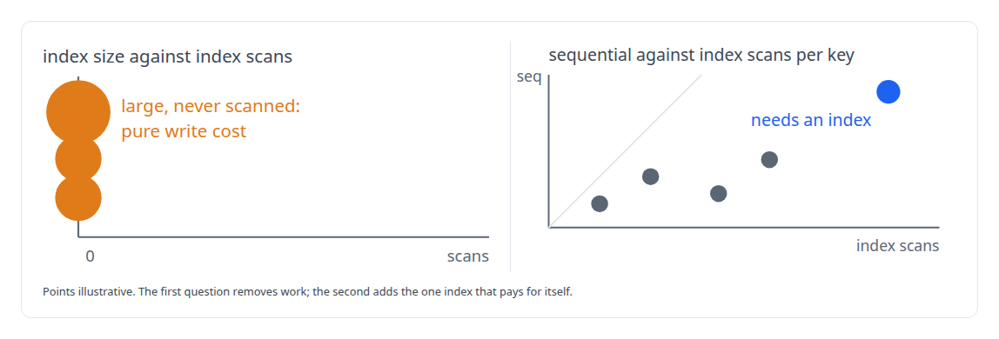
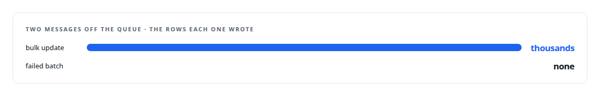

# Twenty thousand rows a second

**A batch update that took twenty-five seconds became a third of a second: one SQL rewrite that makes parameter count independent of row count, and nearly 400 GB of indexes that nobody had ever read**

Canonical: https://coreyjames.ai/stories/twenty-thousand-rows-a-second/  
Author: Corey James · Published: 2026-10-28 · Kind: story  
DOI: https://doi.org/10.5281/zenodo.23735156 (this page is a chapter of the system's report)  
Systems: [PostgreSQL Fabric](https://github.com/coreyjames-ai/postgresql-fabric) · [FAFO Core and Function Forge](https://github.com/coreyjames-ai/fafo-core) · [Inference Fabric](https://github.com/coreyjames-ai/inference-fabric)  
Technologies: [Database performance diagnosis](https://github.com/coreyjames-ai/portfolio/tree/main/technologies/database-performance-diagnosis) · [PostgreSQL](https://github.com/coreyjames-ai/portfolio/tree/main/technologies/postgresql) · [PostgreSQL bulk-update engineering](https://github.com/coreyjames-ai/portfolio/tree/main/technologies/postgresql-bulk-update-engineering) · [Rust](https://github.com/coreyjames-ai/portfolio/tree/main/technologies/rust) · [SQL](https://github.com/coreyjames-ai/portfolio/tree/main/technologies/sql) · [pgvector](https://github.com/coreyjames-ai/portfolio/tree/main/technologies/pgvector) · [sqlx](https://github.com/coreyjames-ai/portfolio/tree/main/technologies/sqlx)  
Skills: [PostgreSQL performance tuning](https://github.com/coreyjames-ai/portfolio/tree/main/skills/postgresql-performance-tuning) · [high-throughput batch inference](https://github.com/coreyjames-ai/portfolio/tree/main/skills/high-throughput-batch-inference) · [vector search and ANN indexes](https://github.com/coreyjames-ai/portfolio/tree/main/skills/vector-search-and-ann-indexes)  


## Result

| Figure | What it measures |
| --- | --- |
| **0.3 s** | per batch update, down from 25 s, with more rows in each |
| **20,000** | rows per second, up from 50, read from the database's own counters |
| **0.19 ms** | per row at most after the rewrite, and as low as 0.06 ms |

## What was built

My research pipeline writes its results back to PostgreSQL through one governed write path, and in a 3.4-million-item run that path was the bottleneck. Each batch update of about 1,350 rows cost roughly 19 milliseconds a row, and the queue behind it grew past 140,000 messages. Two changes fixed it: a different shape of UPDATE statement, and the removal of indexes that had never been used.

## The statement

The original update built a table of values inline, joined it to the target and bound one parameter per cell. PostgreSQL allows 65,535 bind parameters per statement, so a twenty-column payload capped a batch at a few thousand rows, and the planner materialised the whole derived table before it could join. The rewrite binds each column as one array and unnests the arrays into a row set: the parameter count equals the column count whatever the row count, the planner joins directly on the key. The old form is kept as an automatic fallback for types the array path cannot bind. Array-valued columns needed a trick of their own, because unnesting flattens a two-dimensional array; they bind as text arrays of array literals and are cast back in the assignment, and a binary encoder handles two-dimensional arrays where the text path will not do. Vector columns are refused on this path rather than silently mishandled.



## The indexes

The same investigation found three approximate-nearest-neighbour indexes on the table that no query had ever scanned, and every update had been paying to maintain them. They were dropped, with the concurrent recreation commands kept beside the change for rollback. The detection is two catalog queries, and the second is how [196 deadlocks to zero](https://coreyjames.ai/stories/196-deadlocks-to-zero) found its missing update key.



## The result

Measured at the database rather than at the queue, batch time improved around fifty-fold and per-row cost by one hundred to three hundred times, and the backlog drained.


One message can carry a bulk update of thousands of rows or fail and write none, so throughput is read from the database's own tuple counters and commit counts, never from queue length.



A collector bug that divided a decimal by a float had been silently dropping samples; the fix casts to an integer, and the ground-truth formula is written down.

## What this demonstrates

Database performance work done from the engine's point of view: a statement shaped for the planner and the protocol limit, index cost counted as write cost, and results measured where they are true.

The rewrite and the index decision were mine; AI coding agents, a mix of frontier and open-source models, implemented them under my governance system.

> A queue message is not a row.

## What was verified

Each line is a claim the canonical page supports, with the figure as the page states it.

- PostgreSQL performance tuning: a batch update cut from 25 s to 0.3 s by binding one array per column, with per-row cost of 0.06-0.19 ms.
- SQL query design: a parameter count independent of row count under PostgreSQL's 65,535 bind-parameter limit, with the old form kept as a fallback.
- Index cost analysis: never-scanned approximate-nearest-neighbour indexes found through two catalog queries and dropped, with recreation commands kept for rollback.
- Throughput measurement methodology: throughput read from the database's own tuple and commit counters, 50 to 20,000 rows per second, never from queue length.

## Related

- [196 deadlocks to zero](https://github.com/coreyjames-ai/fafo-core/tree/main/stories/196-deadlocks-to-zero) · https://coreyjames.ai/stories/196-deadlocks-to-zero/
- [A write path that sizes itself](https://github.com/coreyjames-ai/postgresql-fabric/tree/main/stories/a-write-path-that-sizes-itself) · https://coreyjames.ai/stories/a-write-path-that-sizes-itself/
- [Redistribution inside the database](https://github.com/coreyjames-ai/fafo-core/tree/main/stories/redistribution-inside-the-database) · https://coreyjames.ai/stories/redistribution-inside-the-database/

## Citation

Corey James. "Twenty thousand rows a second." coreyjames.ai, 2026. https://coreyjames.ai/stories/twenty-thousand-rows-a-second/ In: the PostgreSQL Fabric technical report, doi:10.5281/zenodo.23735156.

```bibtex
@misc{coreyjames-twenty-thousand-rows-a-second,
  author = {Corey James},
  title = {Twenty thousand rows a second},
  year = {2026},
  howpublished = {\url{https://coreyjames.ai/stories/twenty-thousand-rows-a-second/}},
  note = {GitHub copy: https://github.com/coreyjames-ai/postgresql-fabric/tree/main/stories/twenty-thousand-rows-a-second},
  doi = {10.5281/zenodo.23735156}
}
```

Part of [PostgreSQL Fabric](https://github.com/coreyjames-ai/postgresql-fabric) and [Corey James's portfolio](https://github.com/coreyjames-ai/portfolio) · site: https://coreyjames.ai/ · MCP server: https://coreyjames.ai/mcp · agent card: https://coreyjames.ai/.well-known/agent.json
